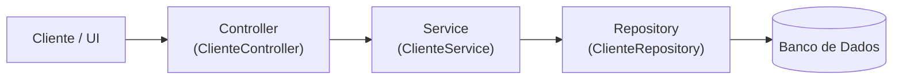

# Sistema de Gestão de Oficina - Wireframes & Protótipo

Projeto desenvolvido a partir de 8 User Stories para otimização do atendimento e gestão de ordens de serviço.

---

## 🔗 Links do Figma

 **Arquivo de Design (Wireframes):** [Ver projeto no Figma](https://www.figma.com/design/Z8dEX9KJsuGR7TwYFpxTNZ/oficina?node-id=0-1&t=75KKMT3Tir5XDcpz-1)
 **Protótipo Interativo (Navegável):** [Executar Protótipo](https://www.figma.com/proto/Z8dEX9KJsuGR7TwYFpxTNZ/oficina?node-id=4-3&p=f&t=raYmocaeMxpYCXky-1&scaling=min-zoom&content-scaling=fixed&page-id=0%3A1&starting-point-node-id=4%3A3)

---

##  Mapeamento das User Stories

O protótipo é composto por 7 telas, cada uma cobrindo uma ou mais User Stories:

| US | Descrição Resumida | Tela Correspondente no Protótipo |
| :--- | :--- | :--- |
| **US1** | Agendar conserto de veículo | **Tela 0** — Agendamento Online (Cliente) |
| **US2** | Aprovar orçamento do conserto | **Tela 3** — Aprovação de Orçamento (Mobile) |
| **US3** | Receber notificação de conclusão | **Tela 6** — Sucesso e Emissão de NF (Modal) |
| **US4** | Visualizar lista de agendamentos do dia | **Tela 1** — Fila de Atendimento (Dashboard) |
| **US5** | Registrar peças utilizadas | **Tela 4** — Detalhes da OS e Peças |
| **US6** | Cadastrar novos clientes e veículos | **Tela 2** — Novo Cadastro |
| **US7** | Registrar pagamento do serviço | **Tela 5** — Checkout e Pagamento |
| **US8** | Emitir nota fiscal | **Tela 6** — Sucesso e Emissão de NF (Modal) |

> **Nota:** US1 (Agendamento) e US6 (Cadastro) foram separadas em duas telas distintas — uma para o autoatendimento do cliente (Tela 0, mobile) e outra para o cadastro feito pela recepcionista (Tela 2, desktop) — já que são fluxos e usuários diferentes.

### Fluxo de navegação (Prototype)

```
Tela 1 (Fila) ──[Novo Cadastro]──▶ Tela 2 (Cadastro) ──[Salvar]──▶ Tela 1
Tela 1 (Fila) ──[card "Aguardando Aprovação"]──▶ Tela 3 (Orçamento Mobile)
Tela 3 ──[Aprovar Orçamento]──▶ Tela 4 (Detalhes da OS)
Tela 4 ──[Concluir Serviço]──▶ Tela 5 (Pagamento)
Tela 5 ──[Registrar Pagamento]──▶ Tela 6 (Sucesso / NF)
```

---

##  Componentes Base (Design System)

* **Button** — variantes `Primary` e `Secondary`
* **Text Field** — campo com label + placeholder
* **Status Tag** — variantes `Pendente`, `Em Execução`, `Aguardando Aprovação`, `Concluído`
* **Sidebar** — menu lateral das telas desktop
* **Vehicle Card** — card de veículo usado na Tela 1 (Kanban)

---

##  Registro de Melhorias

| Data | Tela / Elemento | Problema Inicial | Melhoria / Solução Aplicada | Justificativa (US) |
| :--- | :--- | :--- | :--- | :--- |
| DD/MM | Formulário de Cadastro (Tela 2) | Muitos campos soltos, difícil leitura. | Agrupado em 2 colunas: Dados do Cliente / Dados do Veículo, com busca por CEP. | **US6:** evitar erros de digitação e acelerar o processo da recepção. |
| DD/MM | Orçamento Mobile (Tela 3) | Cliente via apenas o valor total do conserto. | Mão de Obra e Peças separadas com sub-totais visuais. | **US2:** cliente precisa entender a diferença para aprovar rápido. |
| DD/MM | Fila do Mecânico (Tela 1) | Era apenas uma lista em texto simples. | Transformada em Cards de status (Kanban) com o defeito relatado. | **US4:** mecânico precisa ver prioridade e defeito sem papel impresso. |
| DD/MM | Peças e Serviço (Tela 4) | Faltava um lugar claro para registrar peças usadas. | Seção de busca + lista de peças com quantidade e remoção. | **US5:** mecânico registra peças usadas sem retrabalho. |
| DD/MM | Pagamento (Tela 5) | Não havia forma clara de escolher o método de pagamento. | Opções PIX / Cartão / Dinheiro em botões grandes + validação do valor. | **US7:** recepcionista baixa o pagamento rápido e sem erro. |

> Esta tabela também está reproduzida dentro do próprio arquivo Figma, como um frame de documentação ("Registro de Melhorias") logo abaixo das telas.

---

## 🏛️ Arquitetura em Camadas e MVC

Refatoração da funcionalidade de cadastro para o padrão de arquitetura em camadas e MVC, isolando responsabilidades e regras de negócio.

### 1. User Story Selecionada
* **US6 — Cadastrar novos clientes e veículos** (Correspondente à *Tela 2 — Novo Cadastro* do Protótipo).
* **Motivação da escolha:** O cadastro de clientes e veículos é a porta de entrada para as operações essenciais da oficina (agendamentos, ordens de serviço, orçamentos e pagamentos). Representa com clareza o fluxo completo de entrada de dados, validações de negócio e persistência isolada.

### 2. Diagrama da Arquitetura

Fluxo básico em camadas (Controller → Service → Repository):



### 3. Estrutura de Pastas e Responsabilidades das Camadas

A estrutura foi organizada seguindo a separação de responsabilidades descrita no material didático:

```
src/main/java/com/oficina/
├── OficinaApplication.java        # Ponto de inicialização Spring Boot
├── controller/                    # Endpoints HTTP (enxutos, sem regra de negócio)
│   └── ClienteController.java
├── service/                       # Regras de negócio e orquestração de casos de uso
│   └── ClienteService.java
├── repository/                    # Abstração de persistência e acesso a dados
│   ├── ClienteRepository.java
│   └── VeiculoRepository.java
├── model/                         # Entidades de domínio (Cliente, Veiculo)
│   ├── Cliente.java
│   └── Veiculo.java
├── dto/                           # Contratos de transferência de dados (Request / Response)
│   ├── ClienteRequestDTO.java
│   ├── ClienteResponseDTO.java
│   └── VeiculoDTO.java
└── exception/                     # Exceções de domínio e tratamento global de erros
    ├── CpfDuplicadoException.java
    ├── CpfInvalidoException.java
    ├── PlacaInvalidaException.java
    ├── ErrorResponse.java
    └── GlobalExceptionHandler.java
```

| Camada | Responsabilidade Principal | O que foi evitado |
| :--- | :--- | :--- |
| **Controller** | Receber requisição HTTP, validar sintaxe básica de entrada e devolver status/payload apropriado. | Regras de negócio, cálculos, acessos diretos a banco de dados. |
| **Service** | Orquestrar o caso de uso, validar CPF duplicado, integridade de veículos e gerenciar transações. | Acoplamento com detalhes HTTP (HttpServletRequest, ResponseStatus direto no código). |
| **Repository** | Interface declarativa de persistência com Spring Data JPA. | Regras de negócio ou lógicas da aplicação. |
| **Model / Domain** | Representar entidades do negócio com seus comportamentos essenciais. | Conhecimento sobre UI ou detalhes de apresentação. |
| **DTO** | Proteger entidades internas, expondo apenas os dados necessários no tráfego da API. | Expor detalhes de persistência ou anotações internas. |
| **Exception** | Centralizar e padronizar o tratamento de falhas e erros de negócio via `@RestControllerAdvice`. | Tratar exceções manualmente em blocos try/catch nos Controllers. |

